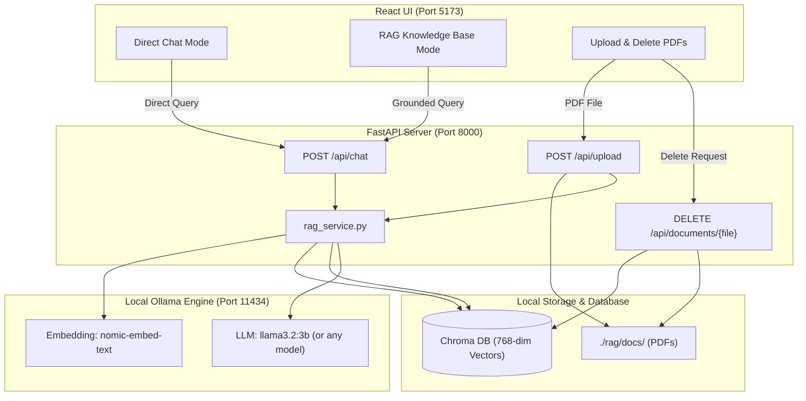

# 🦙 LocalAI-RAG: Private Local RAG & Chat Assistant

A full-stack, 100% free, and private AI application built with **React**, **FastAPI**, **Chroma DB**, and **Ollama**.

Run large language models and vector document search completely on your own machine — **$0 cloud cost, no API keys, and zero data leaving your computer**.

---

## ✨ Features

- **💬 Direct Chat Mode**: Converse directly with local LLMs (e.g., Llama 3.2, DeepSeek-R1, Mistral, Qwen) with zero document restrictions.
- **📄 Multi-Document RAG Mode**: Upload multiple PDF documents into a persistent vector knowledge base. Ask questions and receive grounded answers with exact **Filename + Page number** citations.
- **💾 Local SQLite Chat History & Multi-Turn Memory**: All conversations are stored in a local SQLite database (`chat_history.db`). Browse past chat threads in the sidebar, switch conversations, and enjoy conversational memory across turns.
- **🗑️ Dynamic Vector Deletion**: Delete documents directly from the UI. Only the vector embeddings for that specific document are removed from Chroma DB without corrupting or resetting the database.
- **🎨 Modern ChatGPT Dark Theme**: Clean interface built with React and Tailwind CSS featuring starter prompts, expandable citations, and live backend connection indicators.
- **🔌 Bring Your Own Model**: Works with any embedding model and LLM supported by Ollama.

---

## 🏛️ Architecture Overview



---

## 📋 Prerequisites

Before running the project, ensure you have:
1. **[Ollama](https://ollama.com/)** installed and running on your system.
2. **Python 3.10+**
3. **Node.js (v18+)** and `npm`

---

## 🚀 Quickstart Guide

### Step 1: Pull Local Models via Ollama
Ensure the Ollama application is running, then pull the default embedding and language models:

```bash
# 1. Pull the embedding model (Required for RAG)
ollama pull nomic-embed-text

# 2. Pull the language model (Default: Llama 3.2 3B)
ollama pull llama3.2:3b
```

> **Tip for Higher RAM machines (16 GB+)**: You can pull larger models like `ollama pull llama3.1:8b` or `ollama pull deepseek-r1:8b`.

---

### Step 2: Set Up and Start Backend (FastAPI)

```bash
# 1. Navigate to the backend folder
cd rag

# 2. Create and activate a Python virtual environment
python3 -m venv venv
source venv/bin/activate       # On Windows: venv\Scripts\activate

# 3. Install required Python packages
pip install -r requirements.txt

# 4. Start the FastAPI server
python main.py
```

The backend server will start on **`http://localhost:8000`**.  
Interactive API Swagger documentation is available at **`http://localhost:8000/docs`**.

---

### Step 3: Set Up and Start Frontend (React)

Open a second terminal window:

```bash
# 1. Navigate to the frontend folder
cd client

# 2. Install dependencies
npm install

# 3. Start the Vite development server
npm run dev
```

Open your browser and navigate to **`http://localhost:5173`**.

---

## ⚙️ How to Connect Any Other Local LLM or Embedding Model

You can easily switch the models used by the application without changing any database or UI code:

1. **Pull your desired model using Ollama**:
   ```bash
   # Examples of other LLMs:
   ollama pull mistral:7b
   ollama pull deepseek-r1:8b
   ollama pull qwen2.5:7b

   # Examples of other Embedding models:
   ollama pull bge-m3
   ollama pull all-minilm
   ```

2. **Update the configuration in `rag/rag_service.py`**:
   Open [`rag/rag_service.py`](rag/rag_service.py#L11-L12) and update lines 11–12:
   ```python
   # Change these strings to match your Ollama models:
   EMBEDDING_MODEL = "nomic-embed-text"   # e.g., "bge-m3" or "all-minilm"
   LLM_MODEL = "llama3.2:3b"             # e.g., "deepseek-r1:8b" or "mistral:7b"
   ```

3. **Restart your FastAPI backend** (`python main.py`). The system will automatically use the new models.

---

## 🔌 API Endpoints Reference

| Method | Endpoint | Description |
| :--- | :--- | :--- |
| **`GET`** | `/` | Health check endpoint and current indexed document count. |
| **`GET`** | `/api/documents` | Returns a list of all currently indexed documents, page counts, and chunk stats. |
| **`POST`** | `/api/upload` | Accepts a PDF file (`multipart/form-data`), chunks it, and appends vectors to Chroma DB. |
| **`DELETE`** | `/api/documents/{filename}` | Removes a specific document from disk and deletes only its vector embeddings from Chroma DB. |
| **`POST`** | `/api/chat` | Accepts `{ "question": "...", "mode": "chat" \| "rag" }` and returns the generated answer + sources. |

---

## 📁 Project Structure

```text
ollama-rag-chat/
├── .gitignore                        # Ignores venv, chroma DB, uploads, node_modules
├── README.md                         # Project documentation
├── rag/                              # Backend (FastAPI + Chroma + Ollama)
│   ├── docs/                         # Storage for uploaded PDF files
│   │   └── .gitkeep
│   ├── chroma_db/                    # Persistent Chroma vector store (auto-generated, git-ignored)
│   ├── main.py                       # FastAPI server with routes, validation, and CORS
│   ├── rag_service.py                # Document chunking, vector embeddings, and RAG logic
│   └── requirements.txt              # Python dependencies
└── client/                           # Frontend (React + Vite + Tailwind CSS)
    ├── src/
    │   ├── config.js                 # Central config — exports BACKEND_URL
    │   ├── App.jsx                   # Root component — state, handlers, layout
    │   ├── components/
    │   │   └── Sidebar.jsx           # Sidebar — threads, knowledge base, status footer
    │   ├── index.css                 # Tailwind CSS styling
    │   └── main.jsx                  # React entrypoint
    ├── package.json                  # Node dependencies and scripts
    └── vite.config.js                # Vite build configuration
```

---

## 🔒 Privacy & Data Guarantee

- **Zero External API Calls**: All embeddings and text generations are computed locally via your Ollama instance.
- **Local Persistence**: Vector indices are stored in the local SQLite/Chroma instance inside `./rag/chroma_db/`.
- **Offline Capable**: Once models and dependencies are downloaded, this application runs entirely without an internet connection.

